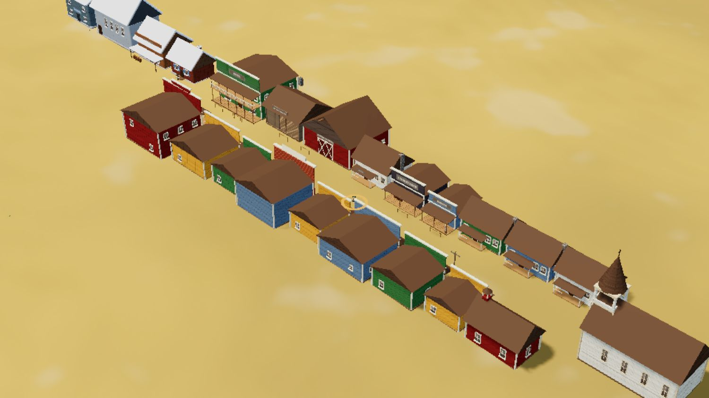
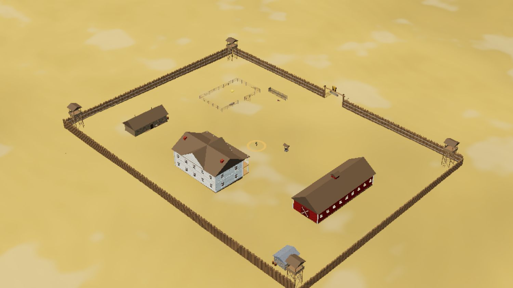
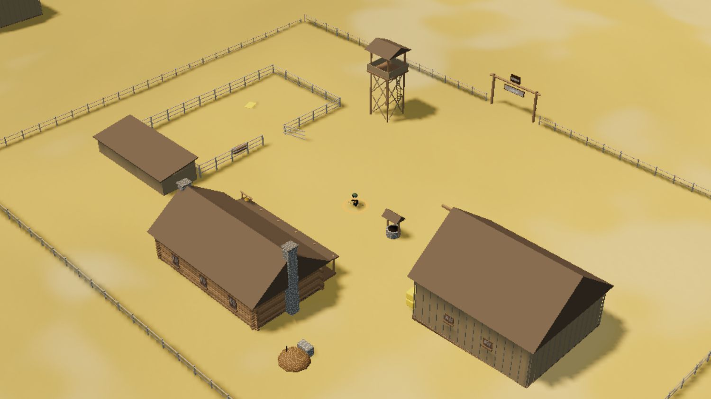

# Guérilla — Far West

*Long Grass Valley, Wyoming, 1885: twelve ranches, a baron, and a guerrilla war on horseback.*

*Long Grass Valley, Wyoming, 1885 : douze ranchs, un baron, et une guerre de partisans à cheval.*

**[English](#en)** · **[Français](#fr)**

---

## English

**The West** is an era of *Guérilla*: the same app and the same engine, another world. The Crown T's baron wants the whole valley and buys the ranches out one by one: an offer first, then threats, cut water and debt. You are Wes or Nell Harlan, a former gunslinger back at the Lazy H, the family ranch. Rally the valley, hold the ranches, weaken the baron, then choose your ending: the law, the people, the gun, or the assault on his big house.

**In development** · Mac, Windows, iPad and iPhone · English and French · Studio Thelba · paid add-on content for *Guérilla*, independent of the Premium Pack

---

### Rulebook

The rulebook covers the whole West: the four endings and the score, the difficulty levels, the valley and its seasons, the 33 people you can rally and whom they trust, the command map, the baron's pressure on the ranches and how to help them, his bands and the Crown T, Liberty and its prices, the law (evidence, the federal judge, the sheriff election, killer reputation), horses, the wagon, weapons and duels, the West's Duel and Raid, the Lazy H Logbook, the controls, a quick reference and an index. **Tip** boxes along the way give players' advice.

- **Read online**: [Rulebook (English)](https://zedoc84.github.io/Guerilla-Ouest/Guerilla-West-Rulebook-EN.html) · [Livret de règles (français)](https://zedoc84.github.io/Guerilla-Ouest/Guerilla-Ouest-Livret-de-regles-FR.html)
- **PDF**, to print or keep: [Guerilla-West-Rulebook-EN.pdf](Guerilla-West-Rulebook-EN.pdf) · [Guerilla-Ouest-Livret-de-regles-FR.pdf](Guerilla-Ouest-Livret-de-regles-FR.pdf)

The online version works on a computer or a phone. It is a single page: save it from your browser to read it offline. The illustrations are screenshots of the game in development.

---

### What the West brings

- **Long Grass Valley**, a 60 or 40 km valley at the foot of the Bighorn Mountains (real terrain, invented names): twelve ranches, the town of Liberty, the railroad with its station and two halts, the Thorne dam, the Blue Vein mine, the Hole-in-the-Rock hideout. The large valley adds Fort Whitcomb, a Crow camp and the Glory Gulch ghost town.
- **Four seasons of seven days**, from late winter to autumn, each with its own nights and weather: rain, thunderstorms, dust storms, blizzards, fog.
- **A campaign against the baron**: each week, the train brings him a new band, his riders put pressure on another ranch, and he throws them at the Lazy H. Help the ranches, scatter his bands by shooting their leaders on their white horses, and drive out the garrisons of the ranches he has bought.
- **Four endings**: by force of arms (the Crown T big house, or its remount stables and all its bands), by the law (a complete case for the federal judge), by the people (an honest sheriff and seven free or allied ranches) or by the Colt (Price, the old rival, then the baron, in a duel).
- **33 people to rally**, each with a home, a trade, a story and the people they trust; random bonds change who follows whom from one game to the next.
- **On horseback and gun in hand**: three gaits and a wind gauge, the wagon for four, the Colt revolver, the Winchester, the double-barrel shotgun, the Sharps, the Bowie knife, dynamite, the spyglass and the torch. Duels at the church bell, simulated or in 3D.
- **Liberty**: the Golden Garter saloon, the general store, the gunsmith, the bank, the land office, the sheriff, the Liberty Gazette, the telegraph, the station… and a common purse of $150 to spend wisely.
- **The West's Duel and Raid**: a duel against ten rivals while a prairie fire closes in on the arena, then the duel at the bell; three Raid scenarios: canyon ambush, raid on the baron's ranch, ranch defence.
- **The Lazy H Logbook**: statistics, distinctions, eight secret files, six hero backgrounds, and 26 achievements.

Everything is open in the West once you own it.

### How to get it

| Platform | How |
|---|---|
| Steam (Mac and Windows) | downloadable content for *Guérilla* |
| App Store (Mac, iPad, iPhone) | in-app purchase in *Guérilla* |
| itch.io (Windows) | a key to enter in the game |

*Guérilla* itself is free: [thelba.itch.io/guerilla](https://thelba.itch.io/guerilla) · coming soon on Steam and on the App Store. Then choose **West** on the title screen.

---

### Credits

Design, the valley, the characters, the story and the rules: original creation by Studio Thelba. Real terrain of the Bighorn Mountains (Wyoming), invented names. Weapons: "Dead West – Animated Western Weapons" pack (Morphara Studio, Unity Asset Store), until the models by Baptiste Barbe, 3D artist, arrive. Characters: Quaternius (CC0). Textures: Poly Haven and ambientCG (CC0). Made with Unity and Blender.

The full list is in the game: **Credits and licenses**, at the bottom of the title screen.

© 2026 Studio Thelba — all rights reserved.

---

## Français

**L'Ouest** est une époque de *Guérilla* : la même application, le même moteur, un autre monde. Le baron du Crown T veut toute la vallée et rachète les ranchs un à un : une offre d'abord, puis les menaces, l'eau coupée et la dette. Vous êtes Wes ou Nell Harlan, ancien pistolero revenu au Lazy H, le ranch de la famille. Ralliez la vallée, tenez les ranchs, affaiblissez le baron, puis choisissez votre fin : la loi, le peuple, le revolver, ou l'assaut de sa grande maison.

**En développement** · Mac, Windows, iPad et iPhone · français et anglais · Studio Thelba · contenu additionnel payant de *Guérilla*, indépendant du Pack Premium

---

### Livret de règles

Le livret couvre tout l'Ouest : les quatre fins et le score, les niveaux de jeu, la vallée et ses saisons, les 33 personnes à rallier et ceux en qui elles ont confiance, la carte d'état-major, la pression du baron sur les ranchs et la façon de les aider, ses bandes et le Crown T, Liberty et ses prix, la loi (les preuves, le juge fédéral, l'élection du shérif, la réputation de tueur), le cheval, le chariot, les armes et les duels, le Duel et le Coup de main de l'Ouest, le Carnet du Lazy H, les commandes, un récapitulatif et un index. Des encadrés **Conseil** donnent, au fil des pages, des conseils de joueur.

- **À lire en ligne** : [Livret de règles (français)](https://zedoc84.github.io/Guerilla-Ouest/Guerilla-Ouest-Livret-de-regles-FR.html) · [Rulebook (English)](https://zedoc84.github.io/Guerilla-Ouest/Guerilla-West-Rulebook-EN.html)
- **En PDF**, pour l'imprimer ou le garder : [Guerilla-Ouest-Livret-de-regles-FR.pdf](Guerilla-Ouest-Livret-de-regles-FR.pdf) · [Guerilla-West-Rulebook-EN.pdf](Guerilla-West-Rulebook-EN.pdf)

La version en ligne se lit sur ordinateur comme sur téléphone. C'est une seule page : enregistrez-la depuis votre navigateur pour la lire hors connexion. Les illustrations sont des captures du jeu en cours de développement.

---

### Ce qu'apporte l'Ouest

- **Long Grass Valley**, une vallée de 60 ou 40 km au pied des monts Bighorn (relief réel, noms inventés) : douze ranchs, la ville de Liberty, le chemin de fer avec sa gare et deux haltes, le barrage Thorne, la mine Blue Vein, le repaire de Hole-in-the-Rock. La grande vallée ajoute Fort Whitcomb, un camp crow et la ville fantôme de Glory Gulch.
- **Quatre saisons de sept jours**, de la fin de l'hiver à l'automne, chacune avec ses nuits et sa météo : pluie, orage, vent de poussière, blizzard, brouillard.
- **Une campagne contre le baron** : chaque semaine, le train lui amène une nouvelle bande, ses cavaliers mettent un autre ranch sous pression, et il les lance sur le Lazy H. Aidez les ranchs, dispersez ses bandes en abattant leurs chefs sur leurs chevaux blancs, chassez les garnisons des ranchs qu'il a rachetés.
- **Quatre fins** : par les armes (la grande maison du Crown T, ou ses écuries de remonte et toutes ses bandes), par la loi (un dossier complet pour le juge fédéral), par le peuple (un shérif honnête et sept ranchs libres ou alliés) ou par le colt (Price, le vieux rival, puis le baron, en duel).
- **33 personnes à rallier**, chacune avec sa maison, son métier, son histoire et ceux en qui elle a confiance ; les liens tirés au sort changent qui suit qui d'une partie à l'autre.
- **À cheval et au revolver** : trois allures et une jauge de souffle, le chariot à quatre places, le revolver Colt, la Winchester, le fusil à deux coups, le Sharps, le couteau Bowie, la dynamite, la longue-vue et la torche. Des duels à la cloche de l'église, simulés ou en 3D.
- **Liberty** : le saloon Golden Garter, le magasin général, l'armurier, la banque, le cadastre, le shérif, la Liberty Gazette, le télégraphe, la gare… et une caisse commune de 150 $ à bien dépenser.
- **Le Duel et le Coup de main de l'Ouest** : un duel contre dix rivaux pendant qu'un incendie de prairie referme l'arène, puis le duel à la cloche ; trois scénarios de coup de main : l'embuscade dans le canyon, le raid sur le ranch du baron, la défense du ranch.
- **Le Carnet du Lazy H** : statistiques, distinctions, huit dossiers secrets, six passés du héros, et 26 succès.

Tout est ouvert dans l'Ouest pour qui l'a acheté.

### Comment l'obtenir

| Plateforme | Comment |
|---|---|
| Steam (Mac et Windows) | contenu additionnel de *Guérilla* |
| App Store (Mac, iPad, iPhone) | achat intégré dans *Guérilla* |
| itch.io (Windows) | clé à saisir dans le jeu |

*Guérilla* lui-même est gratuit : [thelba.itch.io/guerilla](https://thelba.itch.io/guerilla) · bientôt sur Steam et sur l'App Store. Choisissez ensuite **Ouest** sur l'écran titre.

---

### Crédits

Conception, vallée, personnages, récit et règles : création originale de Studio Thelba. Relief réel des monts Bighorn (Wyoming), noms inventés. Armes : pack « Dead West – Animated Western Weapons » (Morphara Studio, Unity Asset Store), en attendant les modèles de Baptiste Barbe, artiste 3D. Personnages : Quaternius (CC0). Textures : Poly Haven et ambientCG (CC0). Réalisé avec Unity et Blender.

La liste complète est dans le jeu : **Crédits et licences**, en bas de l'écran titre.

© 2026 Studio Thelba — tous droits réservés.
